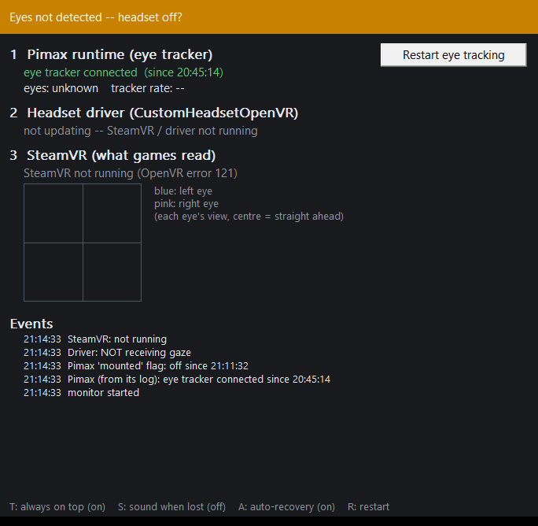

# Pimax Eye Tracking Monitor

A small Windows app that shows whether eye tracking from a Pimax headset is actually reaching SteamVR, and restarts eye
tracking automatically when Pimax's runtime loses the eye tracker and gives up on it.

I wrote it for my Pimax Dream Air, which I run with sboys3's
[CustomHeadsetOpenVR](https://github.com/sboys3/CustomHeadsetOpenVR) SteamVR driver. Eye tracking was being lost for the
whole session after starting SteamVR. The details are in
[sboys3/CustomHeadsetOpenVR#115](https://github.com/sboys3/CustomHeadsetOpenVR/issues/115) and in
[docs/HOW_IT_WORKS.md](docs/HOW_IT_WORKS.md). Pimax and sboys3 couldn't reproduce it, so it may only affect some
systems. If yours is one of them, this fixes it without you having to do anything.

## The problem in short

- With the headset plugged in, Pimax Play starts the eye tracker at boot and eye tracking is fine.
- When SteamVR starts, Pimax Play sees the headset connect again, and 3 seconds later it restarts the Tobii eye tracking
  runtime.
- Sometimes the new Tobii runtime can't open the eye tracker because the old one hasn't let go of it yet
  (`ACCESS_DENIED`). Pimax's server (pi_server) retries for about a second and a half, logs `tobi api failed` and then
  never tries again.
- From then on, SteamVR gets no gaze for the rest of the session. Worse, SteamVR keeps reporting the last gaze as valid,
  so games just see a frozen gaze.
- Turning eye tracking off and on in Pimax Play brings it back most of the time. Because each attempt is another roll of
  the same race, sometimes it needs doing twice.

The monitor watches for that exact log line and does the off/on for you.

## What it does



*Here SteamVR isn't running and the headset is off, so the banner is yellow. When gaze is live it goes green and the plot shows where each eye is looking.*

- **Shows each layer** of the chain from the eye tracker to SteamVR, so you can see where gaze stops:
  1. **Pimax runtime:** whether pi_server is connected to the eye tracker, has lost it, or has given up. Also whether
     the eye tracker sees your eyes, and the tracker rate. This is read from Pimax's own log.
  2. **Headset driver:** whether CustomHeadsetOpenVR is receiving gaze. This is read from the driver's `diagnostic.json`.
     If you don't use that driver, this line just shows "not installed?" and everything else still works.
  3. **SteamVR:** whether gaze is live or frozen in SteamVR. This is the same call games use
     (`GetEyeTrackedFoveationCenter`), and the window plots both eyes' gaze points.
- **Recovers automatically** when pi_server gives up on the tracker. See [Automatic recovery](#automatic-recovery) below.
- **Shows its status in the headset.** There's an "Eye tracking" tab in the SteamVR dashboard with the status and a
  Restart button you can click with the laser. A small red badge appears in view only while eye tracking is frozen with
  the headset on, or while a restart is running.
- **Colours its taskbar button** green, yellow or red, with a coloured dot on the icon. Hovering over the button shows
  a Restart eye tracking button in the preview.
- **Logs every change** to `eye_tracking_monitor_log.txt` next to the exe, with the date and time.

It never starts SteamVR itself. It connects to SteamVR only once SteamVR is already running, and lets go when SteamVR
closes.

## The colours

| Colour | Meaning |
|---|---|
| Green | Gaze is reaching SteamVR. All good. |
| Yellow | Nothing is wrong yet: the headset is off (the tracker sees no eyes), it's waiting for the first gaze after you put it on, it has just reconnected, or eye tracking is switched off in Pimax Play. |
| Red | Pimax has lost the eye tracker or given up on it, Pimax's service has stopped, or the tracker sees your eyes but SteamVR's gaze has been frozen for 15 seconds. |
| Grey | SteamVR isn't running and nothing is wrong on Pimax's side. |

"Worn" means the eye tracker can see your eyes. The Dream Air has no proximity sensor (Pimax confirmed this), so taking
the headset off goes yellow, not red.

## Automatic recovery

When pi_server logs `tobi api failed`, the monitor:

1. Waits 5 seconds, then waits until Pimax's launcher has been quiet for 12 seconds. That way it doesn't step on a
   restart Pimax Play is already doing.
2. Checks that eye tracking is switched on in Pimax Play. If you switched it off yourself, it leaves it off.
3. Restarts eye tracking the way Pimax Play does:
   1. switches eye tracking off;
   2. waits 5 seconds;
   3. switches it back on;
   4. asks Pimax's service launcher to start the Tobii runtime again.
4. If the tracker doesn't come back, it tries again 20 seconds later, up to 3 times in total. After that it stops and
   goes red, and you can press Restart yourself or restart Pimax Play.

It's on by default. Press **A** in the window to turn it off or on.

The off/on switch is the same one as in Pimax Play's settings. The monitor uses Pimax's own `PiPlayService.dll` to flip
it, which is the library Pimax Play itself uses, then puts it back on. It doesn't change any other setting.

## Requirements

- Windows 10 or 11, 64-bit.
- Pimax Play with eye tracking, in its default install folder (`C:\Program Files\Pimax`). I've used it with Pimax Play
  2.0.4 and with the Pimax EVO version.
- SteamVR, for the SteamVR layer and the in-headset tab.
- Optional: sboys3's CustomHeadsetOpenVR driver, for the headset driver layer.

I've only tested it with a Dream Air. It reads Pimax's logs and settings rather than talking to the headset directly, so
other Pimax headsets with Tobii eye tracking may well work, but I can't promise that.

## Install

1. Download `PimaxEyeTrackingMonitor-v1.0.0.zip` from [Releases](../../releases).
2. Extract it to a folder you can write to, e.g. `C:\Tools\PimaxEyeTrackingMonitor`. The log file is written next to
   the exe, so avoid `Program Files`.
3. Run `PimaxEyeTrackingMonitor.exe`.

The exe isn't code-signed, so Windows SmartScreen may warn you the first time. Click **More info**, then **Run anyway**.
The full source is here if you'd rather build it yourself (see [Building](#building)).

To start it with Windows:

1. Press Win+R, type `shell:startup` and press Enter.
2. Put a shortcut to the exe in that folder.

Only one copy runs at a time. Starting it again just brings the existing window to the front.

To remove it, delete the folder (and the startup shortcut if you made one). It doesn't install anything or write to the
registry.

## Using it

Leave it running in the background. If you like, start it with Windows. It only has a few controls:

| Key | What it does |
|---|---|
| R | Restart eye tracking now (same as the button) |
| A | Automatic recovery on / off (on by default) |
| S | A sound when gaze in SteamVR is lost (off by default) |
| T | Always on top on / off (on by default) |

In the headset, open the SteamVR dashboard and pick the **Eye tracking** tab. The big blue button on the right restarts
eye tracking.

The events list in the window and the log file tell you what happened and when. This is a real one from my PC, a few
seconds after starting SteamVR:

```
2026-10-13 21:14:44  Pimax: eye tracker LOST -- Pimax gave up reconnecting
2026-10-13 21:14:54  automatic recovery: Pimax gave up on the eye tracker (21:14:44) -- restarting eye tracking (attempt 1 of 3)
2026-10-13 21:14:54  restart: eye tracking was on -- switching off
2026-10-13 21:14:59  restart: eye tracking switched back on
2026-10-13 21:15:01  restart: asked the Pimax service to start the Tobii runtime (launcher exit 0) -- reconnects in a few seconds
2026-10-13 21:15:03  automatic recovery: the eye tracker is back (after 1 restart)
```

Eye tracking was gone for about 20 seconds, instead of for the whole session.

## What it reads and runs

So you know exactly what it touches:

- **Reads (it never writes to these):**
  - `%LOCALAPPDATA%\Pimax\runtime\pvr_srv_log_*.txt`: pi_server's log (tracker connected / lost / gave up, eyes
    detected, tracker rate).
  - `%LOCALAPPDATA%\Pimax\PiService\Log\PiService__*.log`: Pimax Play's "mounted" flag, only used as a fallback for
    "worn".
  - `%LOCALAPPDATA%\Pimax\PiService\launcher_*.log`: only the file's time, to see whether Pimax Play just sent the
    launcher a command.
  - `%APPDATA%\CustomHeadset\diagnostic.json` and `settings.json`: the CustomHeadsetOpenVR driver's gaze and
    proximity setting.
  - SteamVR, through SteamVR's own `openvr_api.dll`: the gaze, the headset pose, and the dashboard tab.
- **Runs, only when restarting eye tracking:**
  - `C:\Program Files\Pimax\Runtime\PiPlayService.dll`: the eye tracking switch (`piplay_enable_eye_tracking`).
  - `C:\Program Files\Pimax\Runtime\launcher.exe PiServiceLauncher sendCommand active_tobii_runtime`: the same command
    Pimax Play sends when you switch eye tracking on.
- **Writes:** `eye_tracking_monitor_log.txt` next to the exe, and nothing else.

There is no network access, no telemetry and no installer.

## Troubleshooting

- **Layer 1 says "no eye tracker news in the log yet".** pi_server hasn't written anything about the tracker since it
  last started. Put the headset on, or check that Pimax Play is running.
- **Layer 2 says "no diagnostic.json -- driver not installed?".** You're not using CustomHeadsetOpenVR. That's fine,
  because the SteamVR layer is the one that matters.
- **Restart says "could not load ... PiPlayService.dll" or "PiServiceInit failed".** Pimax Play isn't installed in the
  default folder, or its service isn't running. Start Pimax Play.
- **Restart says "PiPlayService.dll doesn't have the expected functions".** A Pimax update has changed the library.
  Please open an issue.
- **Automatic recovery gave up after 3 tries.** Press Restart once more, or quit and restart Pimax Play, then
  SteamVR.
- **The SteamVR tab is empty.** Close and reopen the dashboard. If it stays empty, restart the monitor while SteamVR is
  running.
- **Two monitors?** If you also run an older copy under a different name, close it. Two monitors would both try to
  recover.

If something looks wrong, please open an issue and attach `eye_tracking_monitor_log.txt`. If you can, also attach the
newest `pvr_srv_log_*.txt` from `%LOCALAPPDATA%\Pimax\runtime`.

## Building

You need Visual Studio 2022 (Desktop development with C++) and CMake 3.15 or newer.

```
cmake -S . -B build -G "Visual Studio 17 2022" -A x64
cmake --build build --config Release
```

The exe ends up in `build\Release`. It's a single C++ file using plain Win32. The C++ runtime is linked statically, so
the exe doesn't need the Visual C++ Redistributable. `third_party/openvr/openvr.h` is Valve's OpenVR SDK header, used
for its types only. SteamVR's own `openvr_api.dll` is loaded at run time.

## Credits

- sboys3 for [CustomHeadsetOpenVR](https://github.com/sboys3/CustomHeadsetOpenVR), which is how my Dream Air's eye
  tracking gets into SteamVR in the first place.
- Valve for the [OpenVR SDK](https://github.com/ValveSoftware/openvr) header (BSD 3-Clause, see
  `third_party/openvr/LICENSE`).
- Pimax and Tobii own their software. This tool only reads their logs and calls the same switch Pimax Play uses. It
  isn't affiliated with or endorsed by Pimax, Tobii, Valve or sboys3.

## Licence

MIT. See [LICENSE](LICENSE).
